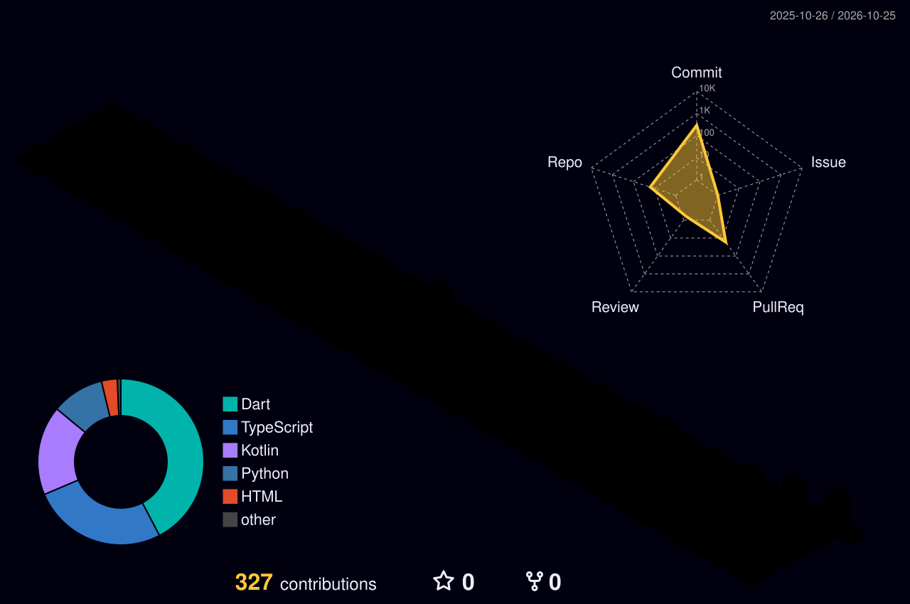

<div align="center">
  
</div>

<div align="center">
  
</div>

<div align="center">
  <a href="https://git.io/typing-svg">
    
  </a>
</div>

<div align="center">
  <a href="mailto:shigwanshreyas4@gmail.com"></a>
  <a href="https://www.linkedin.com/in/shreyas-shigwan4/"></a>
  <a href="https://github.com/Shreyas-84524"></a>
</div>

## `whoami`

```yaml
name: Shreyas-84524
education: TSEC 29'
focus:
  - AI & Machine Learning
  - UI/UX
  - App Development
location: Mumbai, MH
```

## `skills.scan()`

<div align="center">
  
  
</div>

### Currently learning

<div align="center">
  
</div>

## `contributions.render()`

<div align="center">
  
</div>

> The contribution city is regenerated automatically every day by GitHub Actions.

## `projects.list --featured`

<div align="center">
  <a href="https://github.com/Shreyas-84524/ARC">
    
  </a>
  <a href="https://github.com/Shreyas-84524/Swift">
    
  </a>
</div>

| Project | What it does | Built with |
|:--|:--|:--|
| [**ARC**](https://github.com/Shreyas-84524/ARC) | A personal productivity hub for tasks, habits, budgets, and financial insights. | Flutter · Dart · Firebase · Riverpod |
| [**Swift**](https://github.com/Shreyas-84524/Swift) | Connects apps to SMS verification through a self-hosted Android gateway and SIM. | Kotlin · Next.js · TypeScript · PostgreSQL |

## `github.analytics()`

<div align="center">
  
  
</div>

<div align="center">
  
</div>

---

<div align="center">
  <sub>Designing interfaces, building apps, and learning in public.</sub>
</div>
